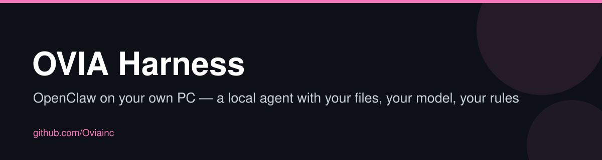

# OVIA Harness — OpenClaw on your own PC

An installable local-agent package for Windows, built on the
open-source [OpenClaw](https://openclaw.ai) framework (MIT). The agent
lives on your own computer — your files, your programs, your terminal —
with a free local model (Ollama) by default and no account required.

**Start with [README-FIRST.md](README-FIRST.md)** — the straight
answer on what this is, what it is not, and how installation works.

## Contents

```
START-HERE.bat                  Double-click launcher on Windows
1-install-openclaw.ps1          Official OpenClaw install + onboarding
2-set-local-model.ps1           Point OpenClaw at your Ollama (free, local)
3-check.ps1                     Health check: gateway, model, dashboard
4-hosted-brain.ps1              Optional hosted model route (parked by default)
workspace/                      The agent's files: AGENTS / SOUL / IDENTITY /
                                USER / TOOLS / MEMORY + starter skills
SECURITY.md                     Localhost-only gateway, token auth, the rules
ANYDESK-AND-ALTERNATIVES.md     Remote access notes
STRONG-OPTIONS.md               Model strength options, honestly priced
```

## Privacy shape

This public package carries **placeholders only** — no names, no phone
numbers, no remote-access IDs, no credentials. Fill in your own copies
locally; never commit the filled versions.

Prepared work, not a claim of installation: nothing runs until the
installer is run on the PC itself.

Part of the OVIA managed AI operations line.
